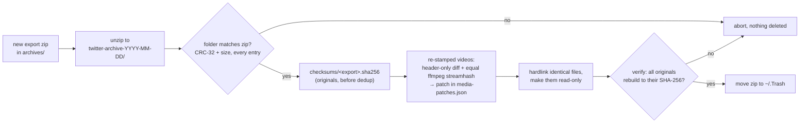

# Twitter(X) Tools

[](https://github.com/pieteradejong/twittertools/actions/workflows/ci.yml)

A full-stack application for analyzing and managing Twitter/X data, featuring a Python FastAPI backend and React frontend.

## Features

* **Comprehensive X API Integration**
  * **Complete X API v2 coverage** - all major endpoints supported
  * **Intelligent caching** with 7-day TTL and automatic cleanup
  * **Rate limit management** with automatic detection and handling
  * **Rich data storage** with JSON fields for complex data structures
  * **CLI and REST API access** for flexible data interaction
* Twitter API Integration
  * Fetch and analyze Twitter likes, tweets, and bookmarks
  * User authentication and profile management
  * Rate limit handling with automatic retries
  * Secure credential caching
* Data Management
  * Local SQLite storage of Twitter data
  * **Semantic tweet classification** using modern NLP (Sentence Transformers)
  * **Multi-label topic filtering** with configurable thresholds
  * **Zero-shot classification** - no training data required
  * User engagement metrics
  * Media attachment tracking
* Modern Interface
  * RESTful API with OpenAPI documentation
  * CLI interface for quick data access
  * React frontend for data visualization
  * List management and recommendations
* Development Tools
  * Colored logging with status indicators
  * Progress tracking and resumable downloads
  * Comprehensive error handling
  * Rate limit monitoring

## Comprehensive X API Support

This project now includes **complete X API v2 coverage** with support for all major data types:

### Supported Data Types
- **Posts/Tweets**: User tweets, search (recent & full archive), mentions
- **Engagement**: Likes, bookmarks, retweets, quote tweets
- **Users**: Profiles, followers, following, blocks, mutes
- **Lists**: User lists, members, followers, tweets
- **Spaces**: Search, tweets, participants
- **Direct Messages**: Conversations and events
- **Communities**: Search, tweets, members
- **Media**: Metadata and metrics
- **Trends**: Trending topics by location
- **Compliance**: Batch compliance jobs

### API Endpoints
Access all X API data through comprehensive REST endpoints:
```http
GET /api/comprehensive/stats                    # Get cached data statistics
POST /api/comprehensive/fetch/tweets           # Fetch user tweets
POST /api/comprehensive/fetch/likes            # Fetch user likes
POST /api/comprehensive/search/tweets/recent   # Search recent tweets
POST /api/comprehensive/fetch/trends           # Get trending topics
# ... and many more
```

### CLI Interface
Use the comprehensive data fetcher for command-line access:
```bash
# Get statistics
python scripts/comprehensive_data_fetcher.py stats

# Fetch user data
python scripts/comprehensive_data_fetcher.py user --user-id 123456789 --data-types tweets likes

# Search tweets
python scripts/comprehensive_data_fetcher.py search --query "python programming" --search-type recent
```

For complete documentation, see [`COMPREHENSIVE_X_API_GUIDE.md`](COMPREHENSIVE_X_API_GUIDE.md).

## Prerequisites

* Python 3.8 or higher
* Node.js 16 or higher and npm
* Twitter/X API credentials:
  * API Key
  * API Secret
  * Access Token
  * Access Token Secret
  * Bearer Token

## Quick Start

1. Clone the repository:
```bash
git clone https://github.com/pieteradejong/twittertools.git
cd twittertools
```

2. Run the initialization script:
```bash
./init.sh
```

3. Fill in your Twitter API credentials in the `.env` file

4. Start the development servers:
```bash
./run.sh
```

The application will be available at:
* Frontend: http://localhost:5173
* Backend API: http://localhost:8000
* API Documentation: http://localhost:8000/docs

## Local archive database

Every X archive export you drop into `archives/` (zip or unpacked) becomes a dated snapshot in
`data/archive.db`. Nothing leaves your machine.

```bash
python -m src.archive_db build              # ingest new exports
python -m src.archive_db changes            # followers gained/lost between snapshots
python -m src.archive_db search 'sqlite'    # keyword search over everything you've liked
./test.sh db                                # its test suite
```

The schema is created by `src/archive_db.py`; its module docstring describes the design.

## Consolidating archive exports

Each X export repeats most of the previous one, and X ships every export as a ~400 MB zip.
`scripts/consolidate_archives.py` keeps `archives/` as **one folder per export with no duplicated
content**, without losing a byte:

```bash
python scripts/consolidate_archives.py plan     # dry run: what would change, bytes saved
python scripts/consolidate_archives.py apply    # do it; stops at the first failed check
python scripts/consolidate_archives.py verify   # every file matches its original SHA-256
./test.sh consolidate                           # its test suite (2 tests need ffmpeg)
```



Requires ffmpeg (`brew install ffmpeg`) for the video check; without it, near-duplicate videos are
simply kept as separate files.

## Development

### Project Structure
```
twittertools/
├── src/                    # Backend Python code
│   ├── main.py            # FastAPI application and CLI
│   ├── comprehensive_x_api_service.py # Complete X API v2 implementation
│   ├── config.py          # Configuration management
│   ├── semantic_classifier.py # Semantic tweet classification
│   └── __pycache__/       # Python cache files
├── scripts/               # Utility scripts
│   ├── download_x_data.py # Twitter data downloader
│   └── comprehensive_data_fetcher.py # CLI for comprehensive X API
├── frontend/              # React frontend (Vite)
│   ├── src/              # React source code
│   │   ├── components/   # React components
│   │   │   └── SemanticLikesFilter.tsx # Semantic filtering UI
│   │   └── App.tsx       # Main application
│   └── .env              # Frontend environment variables
├── data/                 # Local data storage
│   ├── x_data.db        # SQLite database (includes comprehensive tables)
│   └── auth_cache.json  # Credential cache
├── logs/                 # Application logs
│   └── download.log     # Data download logs
├── .env                  # Backend environment variables
├── COMPREHENSIVE_X_API_GUIDE.md # Complete X API documentation
├── IMPLEMENTATION_SUMMARY.md    # Implementation overview
├── init.sh               # Setup script
└── run.sh                # Development server script
```

### Backend Development
The backend is built with FastAPI and provides:

#### API Endpoints
* `GET /health` - Health check endpoint
* `GET /api/me` - Get authenticated user info
* `GET /api/likes` - Get recent likes (with optional count parameter)
* `GET /api/tweets` - Get user tweets
* `GET /api/bookmarks` - Get user bookmarks
* **Comprehensive X API Endpoints:**
  * `GET /api/comprehensive/stats` - Get cached data and API usage statistics
  * `POST /api/comprehensive/fetch/*` - Fetch all types of X API data
  * `POST /api/comprehensive/search/*` - Search tweets and communities
  * `GET /api/comprehensive/data/*` - Access stored comprehensive data
* **Semantic Classification Endpoints:**
  * `GET /api/likes/topics` - Get available topics with counts and statistics
  * `GET /api/likes/by-topic/{topic}` - Filter likes by semantic topic
  * `GET /api/likes/search?query=...` - Semantic similarity search
  * `POST /api/classify/run` - Trigger background classification

#### Features
* **Complete X API v2 integration** with all major endpoints
* **Intelligent caching system** with 7-day TTL and automatic cleanup
* **Rate limit management** with automatic detection and graceful handling
* **Rich data storage** with JSON fields for complex nested data
* Twitter API integration with OAuth and Bearer token support
* Data storage and analysis
* RESTful API with OpenAPI documentation
* **Semantic tweet classification** using Sentence Transformers
* **Multi-topic filtering** with configurable similarity thresholds
* **Zero-shot learning** - works without training data
* CLI interface for quick data access
* Colored logging with status indicators
* Rate limit handling with automatic retries

To run the backend server separately:
```bash
source env/bin/activate
python -m uvicorn src.main:app --reload
```

To use the CLI interface:
```bash
source env/bin/activate
python -m src.main --number 10  # Fetch 10 recent likes
```

To download Twitter data:
```bash
source env/bin/activate
python scripts/download_x_data.py  # Downloads tweets, likes, and bookmarks
```

To use the comprehensive X API CLI:
```bash
source env/bin/activate
python scripts/comprehensive_data_fetcher.py stats  # Get comprehensive statistics
python scripts/comprehensive_data_fetcher.py user --user-id 123456789 --data-types tweets likes
```

> **Note:** Always run the CLI as a module (with `-m src.main`) from the project root to ensure imports work for both CLI and API modes.

### Frontend Development

#### Technology Stack
The frontend is built with modern React technologies:
* **React 18** with TypeScript for type safety
* **Vite** for fast development and optimized builds
* **Tailwind CSS** for utility-first styling
* **Headless UI** for accessible, unstyled interactive components
* **React Query (TanStack Query)** for data fetching and state management

> **Note:** The UI was migrated from Mantine to Tailwind CSS + Headless UI. All new UI should use Tailwind CSS and Headless UI only.

#### Component Architecture
The frontend follows a clean, domain-driven architecture for better maintainability:

```
frontend/src/components/
├── layout/              # Application layout & navigation
│   ├── Layout.tsx       # Main layout wrapper
│   ├── Sidebar.tsx      # Navigation sidebar
│   ├── MenuItem.tsx     # Individual menu items
│   ├── MainContent.tsx  # Content area wrapper
│   └── index.ts         # Barrel exports
├── tweets/              # Tweet-related functionality
│   ├── Tweet.tsx        # Individual tweet display
│   ├── TweetList.tsx    # Tweet feed with pagination
│   ├── SemanticLikesFilter.tsx # Advanced filtering UI
│   └── index.ts
├── users/               # User & social features
│   ├── UserList.tsx     # Generic user listing
│   ├── FollowingList.tsx
│   ├── FollowersList.tsx
│   └── ListsList.tsx
├── communication/       # Messaging & replies
│   ├── DirectMessageList.tsx
│   └── ReplyList.tsx
├── profile/             # Profile management
│   ├── ProfileEnrichment.tsx
│   └── AuthStatus.tsx
├── common/              # Reusable UI components
│   ├── LoadingState.tsx # Standardized loading spinner
│   ├── EmptyState.tsx   # Empty state with icon/message
│   ├── ErrorState.tsx   # Error handling with retry
│   └── index.ts
└── tabs/                # Tab routing system
    └── TabRegistry.tsx  # Centralized tab management
```

#### Key Features

**🎯 Domain-Based Organization**
- Components grouped by functionality for better maintainability
- Clear separation of concerns between layout, data, and UI components
- Barrel exports for clean import statements

**🔄 Tab Registry System**
- Centralized mapping of tabs to components
- Eliminates long conditional chains in render logic
- Easy to add new features without touching core routing code
- Built-in placeholder system for unimplemented features

**🧩 Reusable Components**
- Standardized loading, empty, and error states
- Consistent UI patterns across the application
- Self-contained components with their own styling

**📱 Responsive Design**
- Twitter-like constrained width for optimal readability
- Responsive layout that works on all screen sizes
- Consistent spacing and typography using Tailwind's design system

**🎨 Modern UI/UX**
- Clean, minimal interface inspired by Twitter/X
- Smooth hover states and transitions
- Accessible interactive components via Headless UI
- Semantic HTML structure for screen readers

#### Component Hierarchy
```
App
└── Layout
    ├── Sidebar
    │   └── MenuItem (multiple instances)
    └── MainContent
        └── TabRouter
            └── [Dynamic Component based on activeTab]
                ├── TweetList → Tweet (multiple)
                ├── SemanticLikesFilter → Tweet (multiple)
                ├── UserList/FollowingList/etc.
                └── Other specialized components
```

#### Development Commands
```bash
# Start development server
cd frontend
npm run dev

# Build for production
npm run build

# Type checking
npm run type-check

# Linting
npm run lint
```

#### Adding New Features
1. **New Tab**: Add entry to `TabRegistry.tsx` with component mapping
2. **New Component**: Place in appropriate domain folder with index export
3. **Reusable UI**: Add to `common/` folder for cross-domain usage
4. **Styling**: Use Tailwind utility classes, avoid custom CSS

The frontend architecture is designed for scalability and maintainability, making it easy to add new features while keeping the codebase organized and clean.

## API Documentation
Once the backend server is running, visit:
* Swagger UI: http://localhost:8000/docs
* ReDoc: http://localhost:8000/redoc

The API documentation includes:
* Interactive API testing
* Request/response schemas
* Authentication requirements
* Example requests
* **Complete comprehensive X API endpoints**

## Current Status

### Completed Features
* [x] **Complete X API v2 integration** with all major endpoints
* [x] **Comprehensive data storage** with 10+ database tables
* [x] **Intelligent caching system** with TTL and automatic cleanup
* [x] **Rate limit management** with automatic detection
* [x] **CLI interface** for comprehensive data fetching
* [x] **REST API endpoints** for all X API data types
* [x] Twitter API integration
* [x] Basic API endpoints
* [x] CLI interface
* [x] Configuration management
* [x] Health check endpoint
* [x] User authentication
* [x] Likes fetching
* [x] Tweets fetching
* [x] Bookmarks fetching
* [x] **Semantic tweet classification** with Sentence Transformers
* [x] **Multi-label topic filtering** (technology, politics, Miami, etc.)
* [x] **Semantic search** with natural language queries
* [x] **Zero-shot classification** - no training data required
* [x] Colored logging system
* [x] Rate limit handling
* [x] Progress tracking
* [x] Media attachment tracking
* [x] Secure credential caching

### In Progress
* [x] Frontend implementation (React + Tailwind CSS + Headless UI)
* [x] Tweet classification (semantic classification complete)
* [ ] Data visualization
* [ ] List management
* [ ] User engagement metrics

### Planned Features
* [ ] Categorize follows into X List suggestions
* [ ] Advanced tweet analysis and insights
* [ ] Real-time streaming integration
* [ ] Advanced analytics dashboard
* [ ] Data export capabilities

## Account Categorization Data

For categorizing accounts you follow into lists, the current data availability is limited:

### Available Data (following accounts)
* ✅ **User IDs**: All accounts have unique Twitter user IDs
* ✅ **Intent URLs**: Links like `https://twitter.com/intent/user?user_id=123456789`
* ✅ **Account Classifier**: Ready-to-use classification system with multiple methods

### Missing Data (from Twitter archive)
* ❌ **Profile Information**: No bios, usernames, display names, or locations
* ❌ **Content Data**: No tweets or likes from followed accounts in your archive
* ❌ **Engagement Data**: No interaction history or follower counts

### Categorization Solutions
1. **Profile Enrichment** (Recommended): Use the "Profile Enrichment" tab to fetch missing profile data via X API, then use the Account Classifier
2. **Manual Categorization**: Create lists manually based on your knowledge
3. **Content Analysis**: After enrichment, analyze bio text and tweet content for automatic categorization

The Account Classifier supports multiple methods (profile-based, content-based, hybrid) but requires enriched profile data to be effective.

## Documentation

* [`COMPREHENSIVE_X_API_GUIDE.md`](COMPREHENSIVE_X_API_GUIDE.md) - Complete guide to X API v2 implementation
* [`IMPLEMENTATION_SUMMARY.md`](IMPLEMENTATION_SUMMARY.md) - Overview of comprehensive X API features
* [`API_ACCESS_STRATEGIES.md`](API_ACCESS_STRATEGIES.md) - Twitter API access strategies

## Contributing

This project provides a complete platform for X (Twitter) data analysis with comprehensive API coverage, intelligent caching, and flexible access patterns. Contributions are welcome!

## Credential Authentication Cache

To minimize unnecessary API calls, this project caches the validity of Twitter credentials (for both user-level and app-level authentication) using SHA-256 hashes. No secrets are ever stored—only a hash of the credentials and the authentication status (success/failure) are saved locally. This means:

- If you use the same credentials, the system will remember they worked and skip redundant authentication API calls.
- The cache is stored in `data/auth_cache.json`.
- TTL is infinite: once a credential is validated, it is trusted until you change credentials.
- This improves speed and reduces rate limit risk during development.

**Security:** Only hashes are stored, never the actual credentials.

## Logging System

The application uses a comprehensive logging system with the following features:

- Colored console output for better visibility
- Different colors for different types of messages:
  - Auth messages (Cyan)
  - Fetch operations (Magenta)
  - Data processing (Green)
  - Rate limits (Yellow)
  - Errors (Red)
- Emoji indicators for quick status recognition
- Separate file logging (plain text) for parsing
- Detailed progress tracking
- Rate limit monitoring
- Error tracking with full context

Logs are stored in `logs/download.log` and can be used for debugging or monitoring the application's behavior.

## Testing

```bash
./test.sh            # unit tests in tests/ — fast, offline, no credentials
./test.sh archives   # archive-layout guards only
./test.sh db         # archive.db tests only
./test.sh consolidate # archive dedup tests only
./test.sh all        # unit tests + legacy root-level test_*.py scripts
./test.sh lint       # ruff + black --check (advisory, never fails the run)
./test.sh ci         # unit tests + advisory lint
./test.sh -k glob -x # extra args pass through to pytest
```

`tests/` is the maintained suite. The root-level `test_*.py` files predate it, are ad-hoc
scripts with `__main__` blocks, and some need X API credentials or have unresolved relative
imports — they are excluded from the default run and reachable via `./test.sh legacy`.

`tests/test_archive_layout.py` guards the on-disk archive layout: that
`archive_paths.latest_archive()` picks the newest export, that `enrich_likes.find_like_files()`
actually finds it (this glob failed *silently* — loading zero likes and exiting 0 — when the
archives moved), that no script hard-codes a dated export, and that archives stay gitignored.
The checks that need real exports skip themselves when no `archives/` tree is present, so a
fresh clone stays green.

## Local Twitter Archive Data Files

The application now uses local data files from your Twitter archive (the newest export, `archives/twitter-archive-YYYY-MM-DD/data/`, picked by `scripts/archive_paths.py`) as the primary data source. Below are the most relevant files and their purposes:

Archive exports live under `archives/` (gitignored — an X export contains DMs, IP audit logs and
account details, and this repo is public), one folder per export after
`scripts/consolidate_archives.py`.

- `tweets.js`: All tweets posted by the account, including text, metadata, and references to media.
- `like.js`: All tweets liked by the account.
- `block.js`: Accounts blocked by the user.
- `mute.js`: Accounts muted by the user.
- `lists-created.js`: Lists created by the user.
- `lists-member.js`: Lists the user is a member of.
- `lists-subscribed.js`: Lists the user is subscribed to.
- `follower.js`: Accounts following the user.
- `following.js`: Accounts the user is following.
- `direct-messages.js`: One-on-one direct messages.
- `direct-messages-group.js`: Group direct messages.
- `deleted-tweets.js`: Tweets deleted by the user.
- `profile.js`: Profile information (bio, avatar, etc.).
- `account.js`: Account-level information (email, username, creation date, etc.).
- `tweet-headers.js`: Metadata for tweets.
- `tweetdeck.js`: TweetDeck-related data.
- `moments_media/`, `tweets_media/`, `profile_media/`, etc.: Folders containing images, videos, and GIFs shared in tweets, DMs, or as profile media.

For a full list and detailed descriptions, see `data/README.txt` inside your export in your archive.

## Resetting and Reloading the Database

If you need to reset your local SQLite database (for example, after updating your Twitter archive or to fix schema issues), follow these steps:

1. **Reset the database:**
   This will delete the existing database and recreate an empty one with all required tables.
   ```bash
   ./data/reset_db.sh
   ```

2. **Reload your data from the Twitter archive:**
   This will repopulate the database with all your archive data.
   ```bash
   python scripts/load_local_data.py
   ```

This is the recommended way to ensure your database is in sync with your latest Twitter archive. You can safely run these scripts any time you want to start fresh.

## Semantic Tweet Classification

The application includes advanced semantic classification capabilities that allow you to filter and search your Twitter likes by topic using modern NLP techniques.

### Features
* **Zero-shot classification** - No training data required
* **Multi-label support** - Tweets can belong to multiple topics
* **Configurable similarity thresholds** - Adjust sensitivity
* **Real-time semantic search** - Natural language queries
* **Extensible topic system** - Easy to add new topics

### Default Topics
The system comes with three pre-configured topics:
* **Technology** - AI, programming, software development, tech news
* **Politics** - Political discussions, policy, elections, governance
* **Miami** - Local Miami content, events, culture, news

### How It Works
1. **Sentence Transformers**: Uses the `all-MiniLM-L6-v2` model for text embeddings
2. **Cosine Similarity**: Compares tweet content to topic seed phrases
3. **Threshold-based Classification**: Configurable similarity threshold (default: 0.3)
4. **Batch Processing**: Efficient classification of large datasets

### Usage
* **Frontend**: Use the "Semantic Likes" section to filter by topic or search semantically
* **API**: Access classification endpoints programmatically
* **Background Processing**: Trigger classification of all likes via API

### Performance
* Model loading: ~2-3 seconds (cached after first use)
* Classification: ~0.6 seconds per tweet
* Database storage: Efficient indexing for fast retrieval

### Adding New Topics
Topics are defined in `src/semantic_classifier.py` with seed phrases that represent the topic's semantic space. The system automatically handles multi-label classification and similarity scoring.

[DEPRECATED] ~~## Functional requirements~~
* show who I blocked and when, plus reminders to potentially unblock
* show who is not following me back
* show who I am not following back
* attempt to group tweeps I follow into lists that make sense
* attempt to classify and storify my favorites in ways that make sense
* when viewing another user's profile, recommend which if any of your lists that user would be a good fit for
* reply ranking
* for user: ratio replies/original
* for user: how often replies to replies?
* given tweet, find all instances of quoted tweet
* brief into qustionairre to get you started
